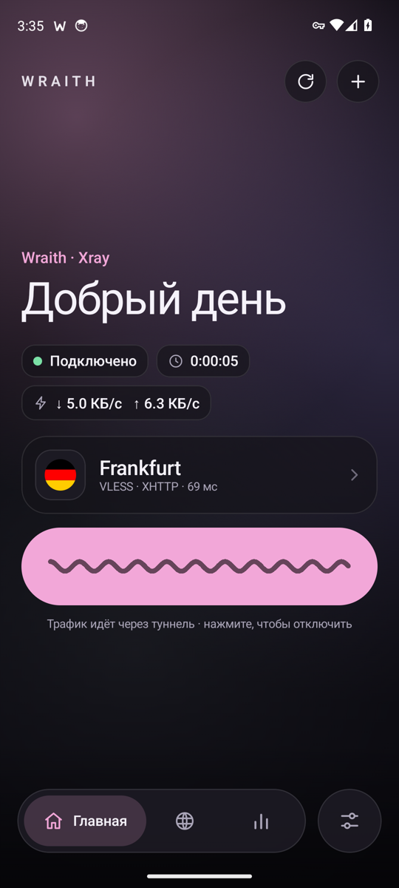
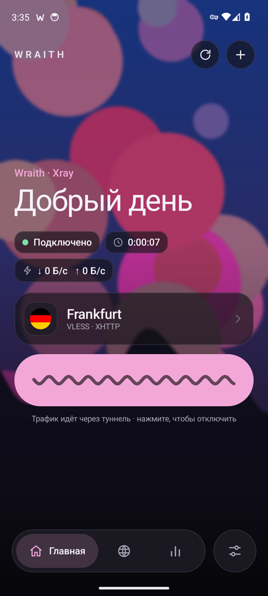
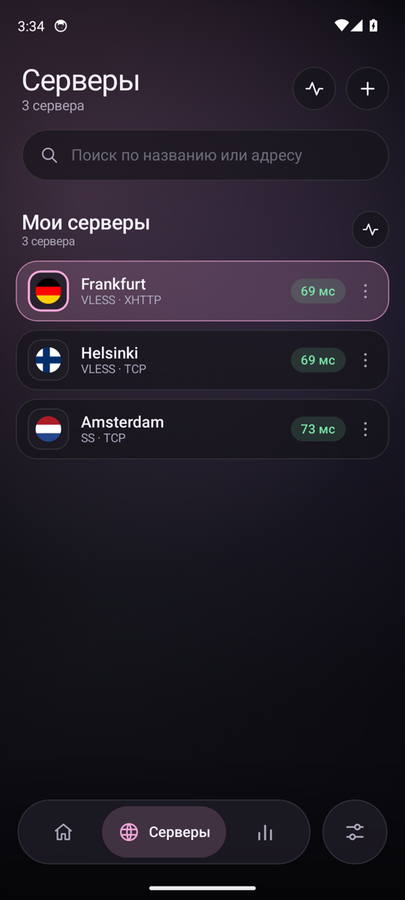
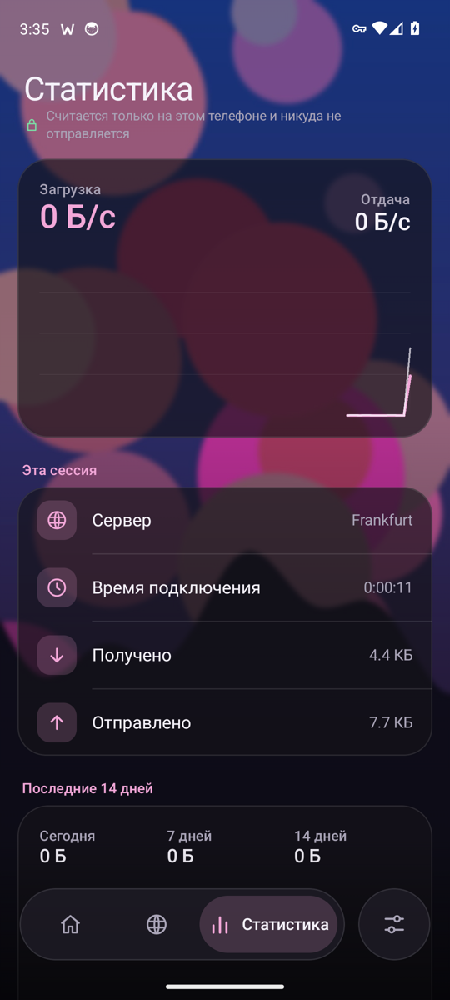

# Wraith for Android

Android VPN client for VLESS / VMess / Trojan / Shadowsocks / Hysteria2 / WireGuard on the **Xray** core. Written in Kotlin with Jetpack Compose. It imports Happ- and v2rayNG-style subscriptions and full Xray JSON, including multi-server configs with balancers (`leastPing` + `observatory`).

> Русский: Wraith — Android-клиент для VLESS/VMess/Trojan/SS/Hysteria2/WireGuard на ядре Xray, на Kotlin и Jetpack Compose. Понимает подписки, полный Xray JSON и авто-конфиги с балансировщиками. Статистика считается только на телефоне и никуда не отправляется.

<p>




</p>

## Features

- **Xray only.** The tunnel runs in an isolated `:xray` process (libXray); latency probes run in a separate `:xray_probe` process.
- **Any Xray transport.** Share links are handed to Xray as they are, so XHTTP, VLESS encryption, gRPC, WS, HTTPUpgrade and Reality all import. Only protocols Xray cannot dial (TUIC, AnyTLS, SSH, Hysteria v1) are refused.
- **Interface.**
  - Your own photo as the background (blur and dimming), or a live gradient that reacts to the connection.
  - Accent colours: presets, the colour of your photo, or Material You.
  - A greeting, live stats in a fixed grid (time, exit IP, delay through the tunnel, speed), a connect button with packets running through it at the speed of the traffic, and a floating tab bar.
- **Statistics that stay on the phone.** Live speed chart, this session, and daily totals for the last 14 days in `files/traffic.json`. Nothing is uploaded.
- **Wraith uses its own tunnel.** With the VPN on, subscription updates, update checks and the exit-IP lookup go through the tunnel. Latency probes deliberately go straight to the server over the real network.
- **Latency checks.** TCP, ICMP (unprivileged ping socket), or a real HTTP GET/HEAD through each server in a short-lived Xray instance. No VPN needed.
- **Subscriptions.** Usage and expiry, announcements, update interval, QR / clipboard / file import, share links and QR export.
- **Routing.** Domain / IP / geosite / geoip rules, provider profiles (`happ://routing/`), per-app split tunnelling, LAN bypass, QUIC blocking, IPv4/IPv6 choice, MTU, fragmentation, noise, mux.
- **Privacy and hardening.**
  - No analytics or telemetry. Updates come from GitHub Releases; the check sends only `User-Agent: Wraith/<version>/Android`.
  - Settings are stored encrypted with the Android Keystore. Cloud backup and device transfer are off.
  - The core opens no metrics or API listener. Traffic is read from the kernel's per-app counters.
  - The local SOCKS5/HTTP proxy is off by default. When it is on, it **always** requires a generated login and password, including on 127.0.0.1. Probe inlets also use a per-batch password.
  - A `wraith://` link from a web page cannot silently turn the VPN off.
  - Provider configs cannot open their own API listeners or write log files.
- Quick Settings tile, boot start, `wraith://connect` / `disconnect` / `toggle` automation links (Happ-compatible `happ://` too).

## Windows and Linux

- **[Wraith-windows](https://github.com/trinity13338/Wraith-windows)**
- **[Wraith-linux](https://github.com/trinity13338/Wraith-linux)**

## Building

Requirements: JDK 17+, Android SDK 35 (build-tools 35.0.0). Gradle 8.10.2 comes with the wrapper.

1. Put `libXray.aar` (libXray v26.9.30, MIT) in `app/libs/`. It is inside `libxray-android.zip` from the [official releases](https://github.com/XTLS/libXray/releases). It is not committed because of its size.
2. Write `sdk.dir=<path to Android SDK>` into `local.properties`.
3. Build:

   ```sh
   ./gradlew assembleRelease
   ```

   Then sign the APK with your own key.

### Updates

The app checks the latest GitHub release of `trinity13338/Wraith-android` (`UpdateChecker.REPO`). It installs the release APK only if the SHA-256 digest GitHub reports for the asset matches. Downloads may only reach GitHub hosts. Forks should change `REPO`.

### Upgrading from 0.12

0.13 is a rewrite in Kotlin. Data from 0.12 is migrated on first start:

- Servers, subscriptions, rules and settings are kept.
- sing-box-only leftovers (full sing-box JSON profiles, `rule_set` / `package_name` rules, sing-box mux and fragment options) are removed and listed in the log.
- A local proxy that was running without a password gets generated credentials.

## License

Wraith is licensed under **GPL-3.0-or-later** (see [LICENSE](LICENSE)). Third-party components:

- Xray-core (MPL-2.0)
- libXray (MIT)
- ZXing / zxing-android-embedded (Apache-2.0)
- Kotlin, Jetpack Compose and AndroidX (Apache-2.0)
- flag-icons (MIT)
- geoip/geosite data from the v2fly projects

See [THIRD_PARTY_NOTICES.md](THIRD_PARTY_NOTICES.md).

Wraith is a client only. No servers are bundled, and no conversion service is used.
